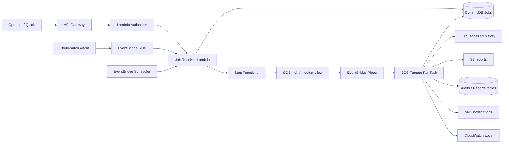

# OpenClaw-AWS

[中文](README.zh-CN.md)

OpenClaw-AWS is a portfolio-oriented CloudOps/AIOps prototype built on AWS. It accepts operator requests, scheduled tasks, and project monitoring alarms; converts them into asynchronous jobs; routes them by priority; runs predefined CloudOps Skills in one-off ECS Fargate tasks; and persists job state, reports, sanitized history, logs, and notifications.

The project is intentionally scoped for a **single-user, low-concurrency environment**. Its goal is to demonstrate cloud engineering, infrastructure-as-code, event-driven orchestration, IAM boundary design, CI/CD controls, and troubleshooting practice—not to present an autonomous production remediation platform.

## What is implemented

The current architecture combines:

- **API Gateway + Lambda Authorizer + Job Receiver Lambda** for protected operator-triggered jobs.
- **CloudWatch Alarms + EventBridge** for project alarm ingestion.
- **EventBridge Scheduler** for optional scheduled inspections and reports.
- **Step Functions + three SQS priority queues** for validation and routing.
- **EventBridge Pipes + ECS Fargate RunTask** for one-off task execution.
- **DynamoDB** for job, alert, and report metadata.
- **EFS** for sanitized short-term task history used by report aggregation.
- **S3** for generated Markdown reports and machine-readable report summaries.
- **CloudWatch Logs** for operational logs and troubleshooting.
- **SNS** for result and alert notifications.
- **Secrets Manager + KMS** for runtime secrets and encryption.
- **Terraform** for dev/prod infrastructure and bootstrap components.
- **GitHub Actions + OIDC** for CI and controlled deployment workflows.

## Job flow



A `202 Accepted` response means the job was accepted for asynchronous processing; it does **not** mean the Fargate task has completed successfully. Likewise, successful Step Functions routing means the job reached the queue, not that the workload itself succeeded. Final outcome is determined from the job record and runtime result.

## CloudOps Skills

| Task type | Skill | Purpose |
| --- | --- | --- |
| `healthcheck` | `aws-task-healthcheck` | Validate runtime identity, configuration, tools, and execution prerequisites. |
| `daily_inspection` | `aws-daily-inspection` | Inspect project resources, monitoring signals, queues, and runtime health. |
| `cost_inspection` | `aws-cost-inspection` | Check cost-related signals and residual-resource risk. |
| `alert_analysis` | `aws-alert-analysis` | Normalize alarm context and produce bounded operational analysis. |
| `report_generation` | `aws-report-generation` | Aggregate structured results into reports and summaries. |

For automated reports, source Skills own the facts and structured evidence. The LLM is constrained to presentation-oriented fields such as executive summary, risk explanation, and recommended actions; it does not overwrite source facts.

## Repository layout

```text
.
├── .github/
│   ├── workflows/              # Active public CI
│   └── deployment-templates/   # Disabled deployment workflow templates
├── infra/
│   ├── bootstrap/              # Remote state and account-level GitHub OIDC
│   ├── envs/                   # dev and prod Terraform roots
│   ├── modules/                # Reusable AWS modules
│   └── scripts/                # Validation, plan, deploy, operations, tests
├── openclaw-agent/
│   ├── skills/                 # CloudOps Skills
│   ├── prompts/                # Bounded prompts used by Skills/reporting
│   ├── tests/                  # Agent-side unit tests
│   ├── Dockerfile
│   └── entrypoint.sh
└── test.sh
```

## Public CI

The active `OpenClaw CI` workflow performs four independent checks:

1. **Repository Safety** — rejects Terraform state/plan files, private variable files, environment files, private keys, packaged Lambda artifacts, and common credential signatures.
2. **Terraform dev/prod Validation** — runs formatting checks, initializes with backends disabled, and validates bootstrap, dev, and prod Terraform roots.
3. **Python, Shell and Agent Tests** — compiles Python, runs the full Python test suite, runs `bash -n` and ShellCheck, and verifies the checks do not modify tracked files.
4. **Docker Build** — builds the OpenClaw Agent image.

At the initial public release, the workflow completed successfully with **58 Python tests passing**.

## Local validation

Prerequisites: Terraform, Python 3, Bash, Git, and Docker. AWS CLI is required for account-aware plan/deploy scripts.

```bash
./infra/scripts/validate.sh

python3 -m venv .venv
.venv/bin/pip install pytest -r openclaw-agent/requirements.txt
.venv/bin/python -m pytest -q \
  openclaw-agent/tests \
  infra/modules/lambda/tests

docker build -t openclaw-aws-agent:local ./openclaw-agent
```

`terraform.tfvars`, Terraform state, saved plan files, real account identifiers, credentials, and private environment-specific outputs are intentionally excluded from this public repository.

## Design choices worth reviewing

- ECS uses **one-off Fargate tasks**, not a continuously running ECS Service.
- Dev and prod use separate Terraform roots, state paths, resource prefixes, secrets, and deployment controls.
- The ECS **Task Execution Role** and **Task Role** are separated.
- GitHub Actions uses **OIDC and short-lived AWS credentials**, not stored AWS access keys.
- Production automation separates **Plan** and **Apply**, checks the saved plan hash, and applies the exact reviewed plan artifact.
- Schedulers are disabled by default to avoid unintended recurring task execution and cost.
- The network baseline uses public subnets for Fargate tasks and does not create a NAT Gateway, reflecting the project's low-concurrency cost trade-off.
- The system performs predefined inspection and reporting workflows; it is **not** an unrestricted autonomous remediation agent.

## Documentation

- [Architecture](docs/architecture.md)
- [Deployment & Setup](docs/deployment.md)
- [CI/CD & GitHub OIDC](docs/ci-cd.md)
- Security & IAM Design — planned
- Operations & Job Lifecycle — planned
- Skills & Report Pipeline — planned
- Incident & Troubleshooting Records — planned
- Changes & Architecture Decisions — planned
- Validation & Evidence — planned
- Limitations & Known Constraints — planned
- Documentation Index & Quick Start — planned

## Project scope

This repository is a sanitized public snapshot prepared for portfolio review. It is designed to make the implementation, engineering trade-offs, validation approach, and operational lessons inspectable without publishing real cloud credentials, private state, or production identifiers.
