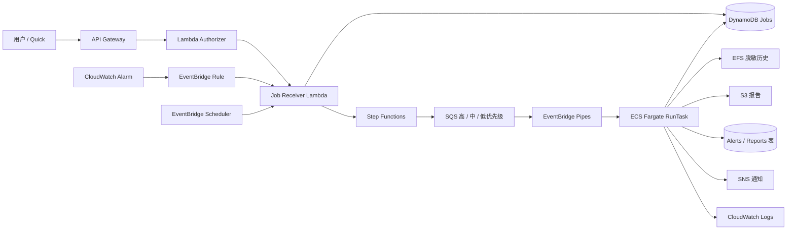

# OpenClaw-AWS

[English](README.md)

OpenClaw-AWS 是一个面向求职展示与工程实践的 AWS CloudOps / AIOps 原型系统。它接收用户主动请求、定时任务和项目监控告警，将请求转换为异步 Job，按优先级进行路由，通过 ECS Fargate 一次性任务运行预定义的 CloudOps Skills，并保存任务状态、报告、脱敏历史、日志与通知结果。

本项目明确面向 **单用户、低并发** 场景。它的主要目标是展示云工程、基础设施即代码、事件驱动编排、IAM 权限边界、CI/CD 控制和排障能力，而不是把项目描述成可以自主修改生产环境的全自动修复平台。

## 当前实现

当前架构主要包括：

- **API Gateway + Lambda Authorizer + Job Receiver Lambda**：接收并鉴权用户主动触发的任务。
- **CloudWatch Alarm + EventBridge**：接收项目监控告警。
- **EventBridge Scheduler**：可选的定时巡检与报告入口。
- **Step Functions + 三条 SQS 优先级队列**：完成任务校验与优先级路由。
- **EventBridge Pipes + ECS Fargate RunTask**：启动一次性容器任务执行 Skill。
- **DynamoDB**：保存 Job、告警和报告元数据。
- **EFS**：保存用于报告聚合的脱敏短期任务历史。
- **S3**：保存 Markdown 报告和机器可读的摘要文件。
- **CloudWatch Logs**：运行日志与排障入口。
- **SNS**：结果和告警通知。
- **Secrets Manager + KMS**：运行时密钥与加密。
- **Terraform**：管理 Dev / Prod 及 Bootstrap 基础设施。
- **GitHub Actions + OIDC**：持续集成与受控部署流程。

## 任务链路



接口返回 `202 Accepted` 只表示任务已经被系统受理并进入异步处理流程，**不代表 Fargate 任务已经执行成功**。同样，Step Functions 成功只代表路由和投递成功，不等于业务任务完成。最终状态需要结合 Job 记录和运行结果判断。

## CloudOps Skills

| 任务类型 | Skill | 主要用途 |
| --- | --- | --- |
| `healthcheck` | `aws-task-healthcheck` | 检查运行身份、配置、工具和执行前置条件。 |
| `daily_inspection` | `aws-daily-inspection` | 巡检项目资源、监控信号、队列和运行状态。 |
| `cost_inspection` | `aws-cost-inspection` | 检查成本相关信号和资源残留风险。 |
| `alert_analysis` | `aws-alert-analysis` | 归一化告警上下文并生成受约束的运维分析。 |
| `report_generation` | `aws-report-generation` | 聚合结构化结果，生成报告和摘要。 |

自动报告链路中，源 Skill 负责事实和结构化证据；LLM 只处理执行摘要、风险解释、建议等表达层字段，不允许覆盖源事实。

## 仓库结构

```text
.
├── .github/
│   ├── workflows/              # 当前启用的公开 CI
│   └── deployment-templates/   # 默认不启用的部署工作流模板
├── infra/
│   ├── bootstrap/              # Remote State 与账号级 GitHub OIDC
│   ├── envs/                   # Dev / Prod Terraform Root
│   ├── modules/                # 可复用 AWS Terraform 模块
│   └── scripts/                # 校验、Plan、Deploy、运维和测试脚本
├── openclaw-agent/
│   ├── skills/                 # CloudOps Skills
│   ├── prompts/                # Skill / 报告使用的受约束 Prompt
│   ├── tests/                  # Agent 单元测试
│   ├── Dockerfile
│   └── entrypoint.sh
└── test.sh
```

## 公开 CI

当前启用的 `OpenClaw CI` 包含四类检查：

1. **Repository Safety**：拒绝 Terraform State / Plan、私有变量文件、`.env`、私钥、打包后的 Lambda 文件以及常见凭据特征。
2. **Terraform dev/prod Validation**：检查 Terraform 格式，在关闭 Backend 的情况下初始化并验证 Bootstrap、Dev 和 Prod Root。
3. **Python, Shell and Agent Tests**：Python 编译检查、完整 Python 测试、`bash -n`、ShellCheck，并确认检查过程没有修改受 Git 跟踪的文件。
4. **Docker Build**：构建 OpenClaw Agent 镜像。

公开仓库首次稳定版本中，CI 已完整通过，Python 测试结果为 **58 passed**。

## 本地验证

基础工具包括 Terraform、Python 3、Bash、Git 和 Docker；需要执行账号相关 Plan / Deploy 时还需要 AWS CLI。

```bash
./infra/scripts/validate.sh

python3 -m venv .venv
.venv/bin/pip install pytest -r openclaw-agent/requirements.txt
.venv/bin/python -m pytest -q \
  openclaw-agent/tests \
  infra/modules/lambda/tests

docker build -t openclaw-aws-agent:local ./openclaw-agent
```

`terraform.tfvars`、Terraform State、保存后的 Plan、真实 AWS Account ID、凭据以及私有环境输出不会进入本公开仓库。

## 值得关注的设计选择

- ECS 使用 **一次性 Fargate Task**，不是长期运行的 ECS Service。
- Dev 与 Prod 使用独立 Terraform Root、State Path、资源名前缀、Secret 和部署控制。
- ECS **Task Execution Role** 与 **Task Role** 分离。
- GitHub Actions 使用 **OIDC + AWS 临时凭据**，不在 GitHub 中保存长期 AWS Access Key。
- Prod 自动化拆分为 **Plan** 与 **Apply**，校验保存 Plan 的 SHA-256，并应用经过审阅的同一份 Plan Artifact。
- Scheduler 默认关闭，避免仓库部署后自动持续触发任务和费用。
- 当前网络基线让 Fargate Task 使用公有子网和 Public IP，并且不创建 NAT Gateway，这是低并发项目中的成本取舍。
- 系统执行的是预定义巡检、分析和报告流程，**不是可以任意修改云资源的自主修复 Agent**。

## 文档

- [系统架构](docs/architecture.zh-CN.md)
- [部署与环境配置](docs/deployment.zh-CN.md)
- [CI/CD 与 GitHub OIDC](docs/ci-cd.zh-CN.md)
- 安全与 IAM 权限设计 — 待补充
- 运维流程与任务生命周期 — 待补充
- Skills 与自动报告链路 — 待补充
- 故障处理与排障记录 — 待补充
- 重要变更与架构决策 — 待补充
- 验证结果与项目证据 — 待补充
- 已知限制与设计约束 — 待补充
- 文档导航与快速开始 — 待补充

## 项目范围

本仓库是为公开求职展示整理的脱敏源码快照。目标是让招聘者能够直接检查实现、工程权衡、验证方式和运维经验，同时不公开真实凭据、Terraform State、生产标识符或其他私有环境信息。
