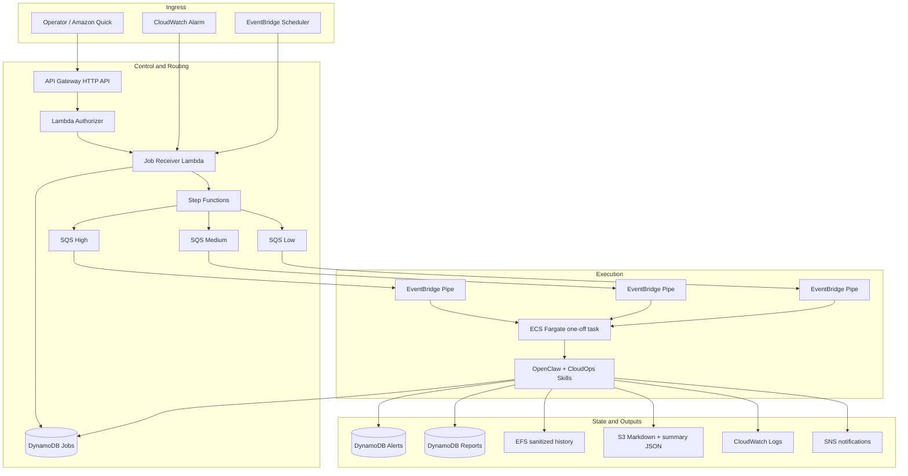

# Architecture

[中文](architecture.zh-CN.md)

## 1. Purpose and scope

OpenClaw-AWS is a low-concurrency CloudOps/AIOps prototype that turns operator requests, schedules, and monitoring alarms into auditable asynchronous jobs. The design evolved from earlier EC2 and always-on-agent options toward a containerized, event-driven model centered on **ECS Fargate RunTask + managed AWS orchestration**.

The architecture is optimized for three goals:

- expose meaningful AWS engineering decisions for portfolio review;
- keep runtime and operational cost bounded for a single-user project;
- preserve a clear separation between **facts/execution** and **LLM-assisted presentation**.

It is not designed as a multi-tenant SaaS platform, a high-throughput queue processor, or an autonomous remediation system.

## 2. High-level architecture



## 3. Ingress paths

### 3.1 Operator-triggered jobs

The public task API is protected by a Lambda authorizer. The operator sends a request through API Gateway, and the authorizer validates the `x-api-key` against the Quick API key stored in Secrets Manager. The Job Receiver Lambda then validates the request, records the job, and starts the routing state machine.

The early POC used a Lambda Function URL to prove that Amazon Quick could invoke a custom OpenAPI connector. The final architecture replaces that probe with the protected API Gateway path.

### 3.2 Alarm-triggered jobs

Project CloudWatch alarms can enter through EventBridge rules and are forwarded to the same Job Receiver. This keeps alert-triggered work on the same job lifecycle as manually submitted work instead of creating a separate execution path.

### 3.3 Scheduled jobs

EventBridge Scheduler can submit morning inspection, afternoon inspection, and weekly report jobs through the same receiver. Scheduling is configurable and **disabled by default** in the environment variables and public deployment flow to avoid unexpected recurring cost.

## 4. Routing and queueing

The Job Receiver creates the initial DynamoDB record and starts Step Functions. The state machine performs controlled routing to one of three SQS queues:

- high priority;
- medium priority;
- low priority.

The queues provide asynchronous decoupling and allow priority-based separation, but they are not presented as a strict global ordering mechanism across all three queues.

Each queue is connected to ECS through an EventBridge Pipe. The pipe starts a one-off Fargate task with the job payload. The current implementation uses a batch size of one so that one queued job maps to one task launch.

## 5. Execution model

The runtime uses **ECS Fargate RunTask**, not a continuously running ECS Service. This was selected after validating containerized OpenClaw/Skill execution in Fargate during the project POC phase.

A task starts the `openclaw-agent/entrypoint.sh` entrypoint, resolves the requested task type, prepares runtime configuration, invokes the corresponding Skill wrapper, and then handles persistence, history, notification, and final job status.

The five implemented Skills are:

- `aws-task-healthcheck`
- `aws-daily-inspection`
- `aws-cost-inspection`
- `aws-alert-analysis`
- `aws-report-generation`

The system executes predefined Python/Boto3 workflows. OpenClaw and the LLM provide bounded orchestration and interpretation where appropriate; they are not granted an unrestricted interface for arbitrary infrastructure changes.

## 6. Job lifecycle and completion semantics

A typical successful lifecycle is:

```text
RECEIVED → DISPATCHING → RUNNING → SUCCEEDED
```

Failure states can include dispatch/start failures and runtime failures.

Two distinctions are important:

- **HTTP 202 Accepted != task success.** It only confirms asynchronous acceptance.
- **Step Functions success != job success.** A successful state-machine execution confirms routing/delivery, not the final exit state of the Fargate workload.

The final outcome should be determined from the DynamoDB job record together with task runtime evidence such as ECS exit status and logs.

## 7. State and data model

| Data | Primary location | Purpose |
| --- | --- | --- |
| Job state and completion metadata | DynamoDB Jobs table | Correlate request, dispatch, runtime, and final state. |
| Normalized alert analysis | DynamoDB Alerts table | Persist structured alert interpretation. |
| Report index / metadata | DynamoDB Reports table | Query and reference generated reports. |
| Sanitized recent task history | EFS | Input for report aggregation without retaining raw sensitive data. |
| Human-readable reports | S3 | Markdown output. |
| Machine-readable report summaries | S3 | Structured JSON summary. |
| Runtime and service logs | CloudWatch Logs | Troubleshooting and operational evidence. |
| Result notifications | SNS | Notify the operator of outcomes and issues. |

EFS history is deliberately sanitized before storage and has bounded retention/configuration. The report-generation Skill can aggregate recent EFS history when explicit input is not supplied.

## 8. Report-generation boundary

The reporting pipeline is designed so that deterministic source Skills remain authoritative:

```text
Source Skill
  → structured result JSON
  → sanitization
  → deterministic template or bounded LLM interpretation
  → aws-report-generation
  → Chinese Markdown report + summary JSON
  → S3 / report metadata
```

The LLM may generate presentation-oriented content such as:

- executive summary;
- risk explanation;
- recommended actions.

It does not replace source status, evidence, or severity with free-form claims.

## 9. IAM and runtime boundaries

The architecture separates several trust boundaries:

- **ECS Task Execution Role**: platform-side startup needs such as pulling ECR images, retrieving runtime secrets, and writing logs.
- **ECS Task Role**: permissions used by code running inside the container.
- **Lambda roles**: separate roles for the authorizer and job receiver.
- **Step Functions role**: workflow routing permissions.
- **EventBridge Pipes / Scheduler roles**: controlled task invocation.
- **GitHub OIDC roles**: separate CI/CD identities for image delivery, Terraform planning, and deployment.

A more detailed permission model is documented separately in the Security & IAM document.

## 10. Network model

The current Terraform baseline creates a VPC with two public subnets. Fargate tasks launched by EventBridge Pipes receive public IPs. EFS mount access is constrained through security groups.

The project does **not** create a NAT Gateway. This is an explicit cost/complexity trade-off for the current low-concurrency portfolio environment and should not be interpreted as a reference private-subnet production architecture.

## 11. Dev and prod separation

Dev and prod are represented by separate Terraform roots:

```text
infra/envs/dev
infra/envs/prod
```

They use separate resource prefixes, state paths, secret resources, report resources, deployment controls, and OIDC roles. Both are constrained to `ap-northeast-1` (Tokyo) in the current baseline.

An account-level GitHub OIDC provider is managed separately under `infra/bootstrap/github-oidc` to avoid duplicating an account-level identity provider in both environment states.

## 12. Architecture evolution

Earlier project design work compared:

- **Option A** — EC2-based long-running Agent for direct control and simpler troubleshooting;
- **Option B** — ECS/Fargate containerized runtime;
- **Option C** — managed orchestration with Step Functions/EventBridge/SQS.

The selected direction combined B + C. Subsequent POCs verified: Amazon Quick could call a custom OpenAPI-backed AWS endpoint; OpenClaw Skills could execute AWS inspection code under an IAM role; and the same Skill/adapter model could run in an ECS Fargate RunTask container.

The final implementation then refined the design further into the current one-off task pipeline, unified job receiver, persistent lifecycle tracking, public CI, dev/prod infrastructure, and report-generation chain.

## 13. Current boundaries

The architecture intentionally does not claim:

- automatic high-risk remediation;
- Kubernetes operation;
- strict global scheduling across priority queues;
- continuous high-availability multi-tenant service behavior;
- private-subnet/NAT-based production networking;
- an independent reconciliation service that always repairs stale job state after every external failure mode.

These boundaries are documented explicitly so the repository can be evaluated on what is actually implemented rather than on aspirational architecture.
