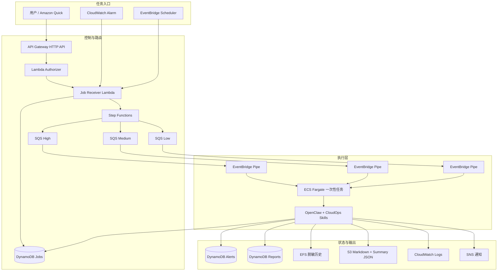

# 系统架构

[English](architecture.md)

## 1. 文档目的与范围

OpenClaw-AWS 是一个低并发 CloudOps / AIOps 原型系统，用于把用户请求、定时任务和监控告警转换成可追踪的异步 Job。项目早期比较过 EC2 长期运行和其他 Agent 形态，最终逐步收敛到以 **ECS Fargate RunTask + AWS 托管编排服务** 为核心的事件驱动架构。

当前架构主要围绕三个目标设计：

- 让求职展示中的 AWS 工程决策能够被直接检查；
- 在单用户场景下控制运行成本和复杂度；
- 明确区分 **事实 / 执行层** 与 **LLM 辅助表达层**。

它不是多租户 SaaS、高吞吐队列处理平台，也不是可以自主执行高风险变更的自动修复系统。

## 2. 总体架构



## 3. 三类任务入口

### 3.1 用户主动触发

公开任务 API 由 Lambda Authorizer 保护。用户通过 API Gateway 提交请求，Authorizer 使用 Secrets Manager 中保存的 Quick API Key 校验 `x-api-key`。通过鉴权后，Job Receiver Lambda 校验请求、创建 Job 记录并启动路由状态机。

项目早期 POC 曾使用 Lambda Function URL 验证 Amazon Quick 是否能够通过自定义 OpenAPI Connector 调用 AWS 后端。正式架构已经将该验证入口替换为带鉴权的 API Gateway 链路。

### 3.2 告警触发

项目 CloudWatch Alarm 可以通过 EventBridge Rule 进入同一个 Job Receiver。这样告警任务和用户任务共享同一套 Job 生命周期，而不是单独维护一条难以追踪的执行链路。

### 3.3 定时触发

EventBridge Scheduler 可以提交上午巡检、下午巡检和周报任务，并同样进入 Job Receiver。当前 Scheduler 为可配置能力，并且在环境变量和公开部署流程中 **默认关闭**，避免仓库部署后自动产生持续任务和费用。

## 4. 路由与排队

Job Receiver 创建初始 DynamoDB 记录后启动 Step Functions。状态机将任务受控路由到三条 SQS 队列之一：

- 高优先级；
- 中优先级；
- 低优先级。

三条队列用于异步解耦和优先级分离，但不把它们描述成跨所有队列的严格全局排序机制。

每条 SQS 队列通过独立 EventBridge Pipe 连接到 ECS。Pipe 为单个 Job 启动一次 Fargate Task；当前设计采用 batch size 1，使一条队列消息对应一次任务启动。

## 5. 执行模型

当前运行模式使用 **ECS Fargate RunTask**，不是长期保持运行的 ECS Service。项目 POC 阶段已经验证 OpenClaw / Skill 的容器化执行链路可以在 Fargate 一次性任务中运行，因此正式架构采用按任务启动的方式。

Task 启动后由 `openclaw-agent/entrypoint.sh` 完成环境准备、任务类型选择、Skill 调用，并在执行后处理状态保存、历史归档、通知和最终 Job 状态。

当前包含五个 Skill：

- `aws-task-healthcheck`
- `aws-daily-inspection`
- `aws-cost-inspection`
- `aws-alert-analysis`
- `aws-report-generation`

实际检查逻辑由预定义 Python / Boto3 程序完成。OpenClaw 和 LLM 只在被限定的编排与解释范围内参与，不提供可以任意修改基础设施的无限制执行接口。

## 6. Job 生命周期与完成语义

典型成功状态为：

```text
RECEIVED → DISPATCHING → RUNNING → SUCCEEDED
```

分发、启动或运行异常可以进入相应失败状态。

项目中特别区分两组容易误判的语义：

- **HTTP 202 Accepted ≠ Task 成功。** 它只代表异步任务已经被系统受理。
- **Step Functions 成功 ≠ Job 成功。** 它只说明路由 / 投递完成，不代表 Fargate 工作负载已经正常结束。

最终结果应结合 DynamoDB Job 记录、ECS Task 退出状态和 CloudWatch Logs 等运行证据判断。

## 7. 状态与数据分层

| 数据 | 主要位置 | 用途 |
| --- | --- | --- |
| Job 状态与完成信息 | DynamoDB Jobs 表 | 关联请求、分发、运行和最终状态。 |
| 结构化告警分析 | DynamoDB Alerts 表 | 保存归一化后的告警结果。 |
| 报告索引 / 元数据 | DynamoDB Reports 表 | 查询并定位生成的报告。 |
| 近期脱敏任务历史 | EFS | 为后续报告聚合提供输入。 |
| 人类可读报告 | S3 | 保存 Markdown 报告。 |
| 机器可读报告摘要 | S3 | 保存结构化 JSON Summary。 |
| 运行日志 | CloudWatch Logs | 排障与运行证据。 |
| 结果通知 | SNS | 向用户发送执行结果和异常信息。 |

EFS 中保存的是经过脱敏的任务历史，并受到保留周期和文件大小限制。`report_generation` 在没有显式输入时，可以聚合指定时间窗口内的 EFS 历史生成报告。

## 8. 自动报告的事实边界

报告链路遵循“源 Skill 负责事实，LLM 负责有限表达”的原则：

```text
源 Skill
  → Structured Result JSON
  → 脱敏
  → Deterministic Template 或受约束 LLM Interpretation
  → aws-report-generation
  → 中文 Markdown + Summary JSON
  → S3 / Report Metadata
```

LLM 可以生成：

- 执行摘要；
- 风险解释；
- 建议动作。

但不能自由改写源 Skill 的状态、证据和严重性事实。

## 9. IAM 与运行边界

架构将不同信任边界拆开：

- **ECS Task Execution Role**：负责拉取 ECR 镜像、读取容器运行密钥、写入日志等平台启动阶段权限。
- **ECS Task Role**：容器内代码实际调用 AWS API 时使用的权限。
- **Lambda Roles**：Authorizer 和 Job Receiver 使用独立 Role。
- **Step Functions Role**：状态机路由所需权限。
- **EventBridge Pipes / Scheduler Roles**：受控启动任务。
- **GitHub OIDC Roles**：镜像交付、Terraform Plan 和 Deploy 使用不同身份。

详细权限边界将在《安全与 IAM 权限设计》中单独说明。

## 10. 网络模型

当前 Terraform 基线创建一个 VPC 和两个公有子网。由 EventBridge Pipes 启动的 Fargate Task 会分配 Public IP；EFS 挂载则由 Security Group 限制。

当前项目 **不创建 NAT Gateway**。这是面向低并发个人项目的成本和复杂度取舍，不应被理解为通用生产环境私有子网架构模板。

## 11. Dev / Prod 隔离

Dev 和 Prod 使用两个独立 Terraform Root：

```text
infra/envs/dev
infra/envs/prod
```

两者具有独立资源名前缀、State Path、Secret、报告资源和部署控制。当前基线同时限制在 `ap-northeast-1`（东京）。

账号级 GitHub OIDC Provider 单独由 `infra/bootstrap/github-oidc` 管理，避免 Dev 和 Prod State 重复管理同一个账号级身份提供者。

## 12. 架构演进

项目早期架构设计曾比较：

- **方案 A**：EC2 长期运行 Agent，控制能力强、排障直接；
- **方案 B**：ECS / Fargate 容器化运行；
- **方案 C**：Step Functions / EventBridge / SQS 托管编排增强层。

最终选择 B + C。之后的 POC 又分别验证了：Amazon Quick 可以通过自定义 OpenAPI 接口调用 AWS 后端；OpenClaw Skill 可以在 IAM Role 下执行 AWS 巡检代码；同类 Skill / Adapter 可以在 ECS Fargate RunTask 容器中运行。

正式实现随后继续演进为当前的一次性任务链路、统一 Job Receiver、持久化生命周期、Dev / Prod Terraform、公开 CI 和自动报告链路。

## 13. 当前边界

当前架构不会宣称已经实现：

- 高风险基础设施自动修复；
- Kubernetes 运维；
- 跨三条优先级队列的严格全局调度；
- 多租户高可用持续服务；
- 私有子网 + NAT 的通用生产网络模板；
- 可以覆盖所有外部失败场景的独立 Job Reconciliation 服务。

公开文档明确保留这些边界，是为了让项目以已经实现和验证的内容接受检查，而不是用未来规划替代当前事实。
